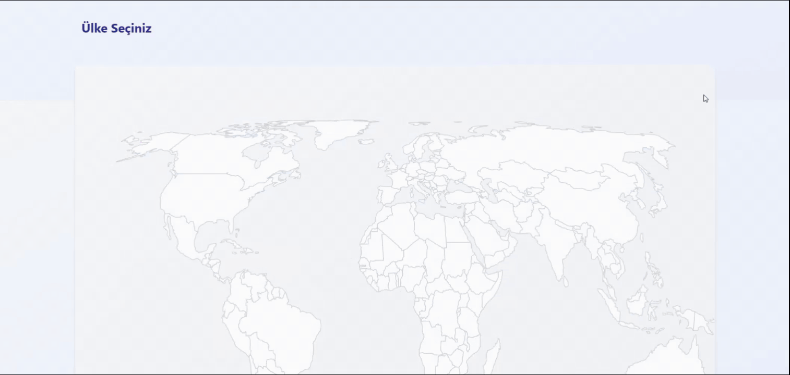

# 🦠 COVID-19 Live Tracking Map

An interactive COVID-19 tracking application built with **React, Redux Toolkit, and Vite**. The application displays global COVID-19 statistics and allows users to explore country-specific data through an interactive world map.

---

## 📌 Project Overview

This project aims to practice modern React development, centralized state management with Redux Toolkit, external API integration, asynchronous data fetching, and unit testing with Jest.

Users can select countries on the interactive world map and explore detailed COVID-19 statistics and country information.

### Key Highlights

- Real-time global COVID-19 statistics
- Interactive world map with country selection
- Detailed country-specific COVID-19 data
- Centralized state management with Redux Toolkit
- Asynchronous API requests using `createAsyncThunk`
- Unit testing with Jest and React Testing Library
- API mocking for independent test environments
- Responsive and modern user interface

---

## 🛠️ Technologies Used

- React 18
- Vite
- Redux Toolkit
- React Redux
- React Router DOM
- JavaScript (ES6+)
- Axios
- Tailwind CSS
- React Simple Maps
- Millify
- Jest
- React Testing Library
- React Icons

---

## ✨ Features

- 🌍 **Global Statistics:** Display worldwide total cases, active cases, and deaths.
- 🗺️ **Interactive World Map:** Select countries directly from the map.
- 📊 **Country Statistics:** View detailed COVID-19 statistics for selected countries.
- 🏳️ **Country Information:** Display country flags, population, capital cities, and currency information.
- 🔄 **API Integration:** Fetch data asynchronously using Axios and Redux Toolkit.
- ⚡ **State Management:** Manage application state with Redux Toolkit.
- ⏳ **Loading States:** Dedicated UI components for loading processes.
- ⚠️ **Error Handling:** Handle API errors and unsuccessful requests.
- 🧪 **Unit Testing:** Test components using Jest and React Testing Library.
- 🔌 **API Mocking:** Mock API requests for independent testing.
- 🎨 **Animations:** Smooth UI transitions with fade-in and slide-up effects.
- 📱 **Responsive Design:** Provide an optimized experience across different screen sizes.

---

## 🧪 Testing

Unit tests are implemented using **Jest** and **React Testing Library**.

The tests cover the main UI components and application functionality, including:

- Statistics components
- Item components
- Title components
- Content components
- API mocking and independent test scenarios

Test files are located in the `src/__tests__` directory.

---

## 🎬 Preview

